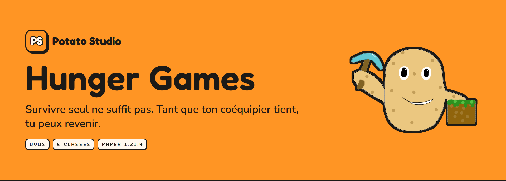
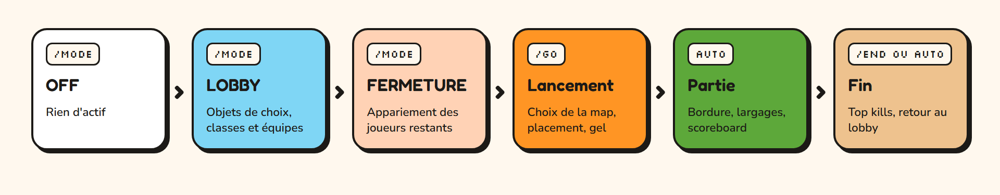
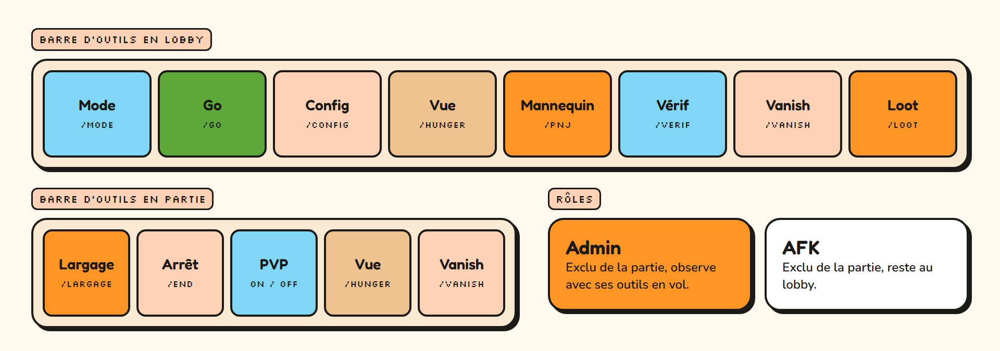
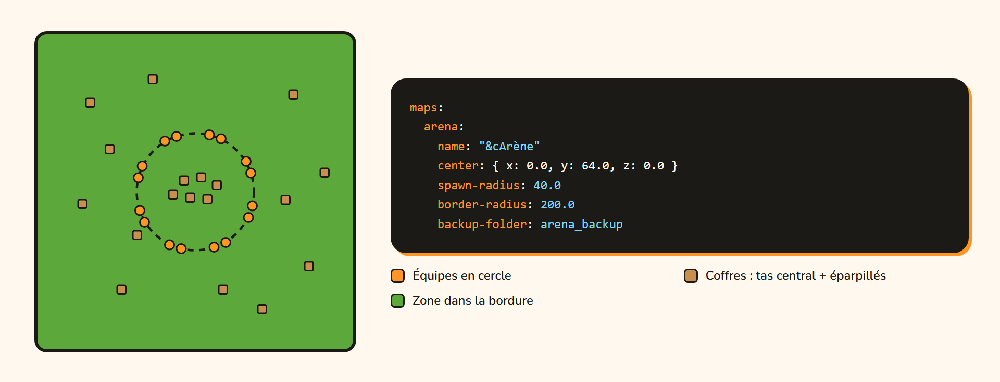
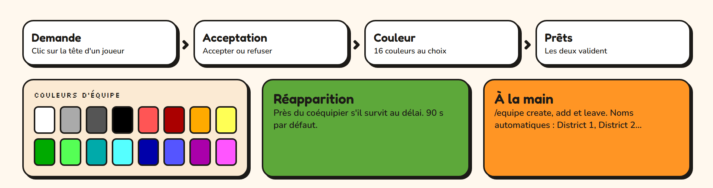
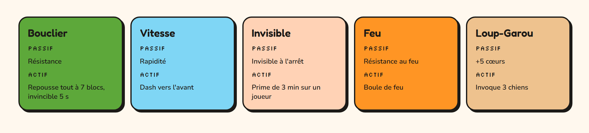
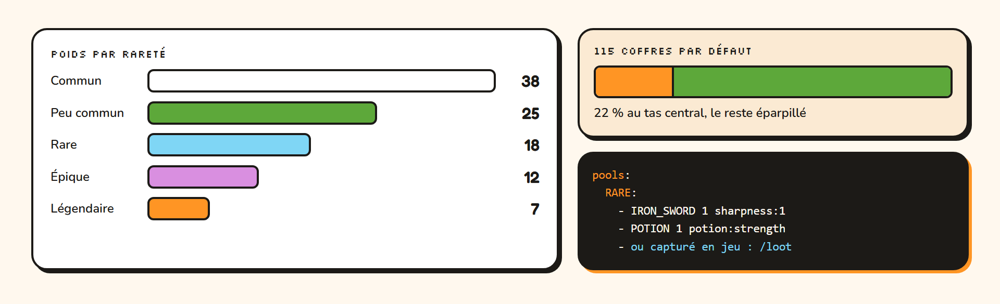
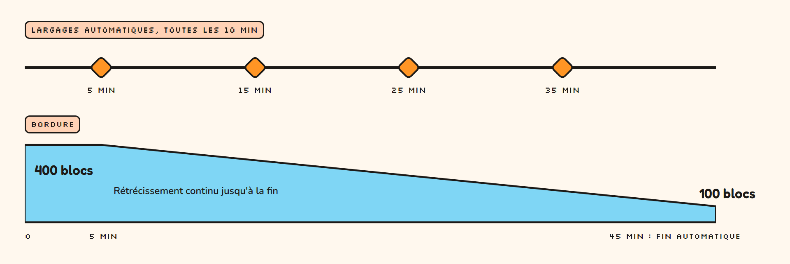
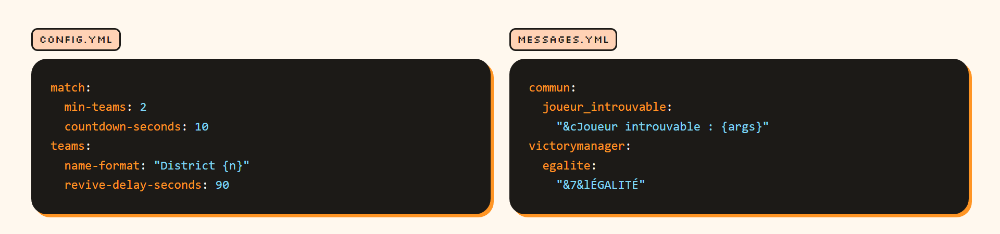

<p align="center">
  
</p>

# Hunger Games

Plugin Paper pour organiser des events Hunger Games en duos, développé par Potato Studio. Il gère tout le cycle d'une partie, du lobby au classement final. Les réglages et les textes sont dans des fichiers de configuration.

## Fonctionnalités

Les valeurs affichées sont celles par défaut, toutes modifiables dans `config.yml`.

### Gestion de partie



- Modes `OFF`, `LOBBY` et `FERMETURE`, puis lancement avec choix de la map et compte à rebours avec joueurs gelés
- Fin automatique à la dernière équipe en vie ou à la durée maximale, clôture manuelle avec `/end`
- Top kills, retour au lobby et nettoyage des coffres en fin de partie
- Scoreboard de partie : joueurs et équipes restants, prochain largage, état de la bordure
- Modes de test à un joueur (`/go test`) et à deux joueurs (`/go test_duo`)

### Administration



- Rôles Admin et AFK, exclus de la partie
- Outils d'administration en objets dans la barre d'action, en lobby comme en partie
- Vue d'ensemble de l'état du jeu avec `/hunger`
- Vanish, mannequins d'entraînement, PVP activable à la demande, resynchronisation d'un joueur

### Maps



- Nombre de maps libre, chacune avec son nom, son centre, son rayon d'apparition et sa bordure
- Chargement automatique des mondes au démarrage, Multiverse-Core facultatif
- Restauration depuis une sauvegarde avec `/resetmap`, manuelle ou automatique après chaque partie

### Équipes



- Duos formés par menu : demande, acceptation, choix de la couleur
- Création et modification manuelles avec `/equipe`
- Appariement automatique des joueurs restants à la fermeture du lobby
- Réapparition près du coéquipier après un délai réglable
- Protection contre les dégâts entre coéquipiers

### Classes



- 5 classes avec un pouvoir passif et un pouvoir actif : Bouclier, Vitesse, Invisible, Feu, Loup-Garou
- Choix par menu, livre de description, recharge réglable
- Hologrammes de présentation pour le lobby avec FancyHolograms

### Coffres et loot



- Nombre de coffres par map, part au tas central, rayons et centres réglables
- 5 raretés à poids réglables, avec 2 variantes de contenu chacune, et un halo de particules par rareté
- Contenu défini dans `config.yml`, ou capturé en jeu depuis un vrai coffre avec son NBT complet (`/loot`)
- Éditeur de pools en jeu, objets limités à un exemplaire par partie

### Bordure et largages



- Délai avant rétrécissement, taille finale, dégâts et avertissement réglables
- Vitesse modifiable en cours de partie avec `/bordure` et `/max`
- Largages automatiques près d'un joueur tiré au sort : 4 variantes de contenu, premier délai, intervalle et rayon réglables
- Largage manuel sur un joueur choisi avec `/largage`

### Déconnexions

- Marquage de combat : une déconnexion élimine aussitôt sous un seuil de vie, sinon après un délai laissé pour revenir

### Personnalisation



- Tous les textes dans `messages.yml`, avec codes couleur et valeurs dynamiques
- Les réglages de `/config` sont enregistrés dans `config.yml`

## Versions

- Minecraft / Paper 1.21.4
- Java 21 ou plus récent

## Installation

1. Copier `HungerGame-<version>.jar` dans `plugins/`, puis démarrer le serveur une fois pour générer la configuration.
2. Placer chaque monde de jeu à la racine du serveur et le déclarer dans la section `maps` de `plugins/HungerGame/config.yml`.
3. Redémarrer. Les mondes sont chargés automatiquement (`load-on-start`). Multiverse-Core reste possible mais n'est pas nécessaire.

[FancyHolograms](https://modrinth.com/plugin/fancyholograms) est facultatif : il n'est utilisé que par `/classeholo`.

## Configuration

Le plugin génère deux fichiers. Un redémarrage est nécessaire pour les prendre en compte, sauf le loot (`/loot recharger`).

**`config.yml`**

| Section | Contenu |
| --- | --- |
| `lobby` | Point d'apparition du lobby |
| `match` | Minimums de joueurs et d'équipes, compte à rebours, délai de fin, top kills |
| `border` | Taille finale, dégâts, avertissement, vitesses de `/bordure` et `/max` |
| `teams` | Format du nom automatique, couleurs, délai après un refus, réapparition |
| `combat-tag` | Règles de déconnexion en combat |
| `airdrops` | Rayon du largage manuel |
| `classes` | Recharge des pouvoirs, durée de la prime |
| `reset` | Réinitialisation automatique après une partie |
| `map-defaults` | Coffres, raretés, délai de bordure, durée maximale et largages communs à toutes les maps |
| `maps` | Une section par monde : nom, icône, centre, rayons, sauvegarde. Peut redéfinir toute valeur de `map-defaults` |
| `loot` | Nombre d'objets par coffre, objets uniques, contenu des pools |

Une ligne de pool s'écrit `MATERIAU quantité [enchantement:niveau ...] [potion:type]`, par exemple `DIAMOND_SWORD 1 sharpness:2` ou `SPLASH_POTION 1 potion:poison`. `/loot` permet aussi de capturer un coffre en jeu : la capture, stockée dans `chest-items.yml` avec le NBT complet des objets, remplace le pool correspondant.

`/config` modifie les coffres et les durées d'une map en jeu et écrit dans `config.yml`.

**`messages.yml`** contient tous les textes. Les couleurs s'écrivent avec `&`, les valeurs dynamiques entre accolades (`{joueur}`). Les durées citées dans les textes, comme le livre de classe (« Recharge : 3 minutes »), sont à adapter à la main si vous changez `config.yml`.

Les équipes sont limitées à 2 joueurs. Les classes (nombre, pouvoirs) sont définies dans le code.

## Déroulé d'une partie

1. **`/role add admin <joueur>`** : les admins reçoivent leur trousse d'outils et ne jouent pas. `afk` exclut aussi un joueur de la partie.
2. **`/mode` → LOBBY** : chaque joueur reçoit les objets pour choisir sa classe et son équipe.
3. **`/mode` → FERMETURE** : les joueurs restants sont appariés au hasard, les classes manquantes sont demandées.
4. **`/go`** : choix de la map. Les équipes sont placées en cercle, les coffres apparaissent, puis un compte à rebours gèle tout le monde.
5. **Partie** : le PVP s'active. La bordure rétrécit après son délai et des largages tombent régulièrement. Un joueur mort réapparaît près de son coéquipier si celui-ci survit au délai ; sinon, il passe spectateur.
6. **Fin** : dernière équipe en vie, durée maximale atteinte ou `/end`. Le top kills s'affiche, puis tout le monde revient au lobby.

Pour tester : `/go test` autorise une partie avec une seule équipe (sans détection de victoire), et `/go test_duo` oppose deux joueurs connectés avec le flux normal.

## Commandes et permissions

Toutes les permissions valent `op` par défaut.

| Commande | Permission | Rôle |
| --- | --- | --- |
| `/hunger` | `hungerGame.hunger` | Vue d'ensemble de l'état du jeu |
| `/mode [lobby\|off <joueur>]` | `hungerGame.mode` | Change le mode, ou resynchronise un joueur |
| `/role <add\|remove> <admin\|afk\|tous> <joueur\|@a>`, `/role list <joueur\|@a>` | `hungerGame.role` | Gère les rôles |
| `/classe [leave <joueur>]` | `hungerGame.classe` | Ouvre le choix de classe ou retire une classe |
| `/equipe [create <joueur> <nom> <couleur>\|add <joueur> <équipe>\|leave <joueur>]` | `hungerGame.equipe` | Ouvre le choix d'équipe ou gère les équipes à la main |
| `/verif` | `hungerGame.verif` | Force le choix d'équipe puis de classe |
| `/go [test\|test_duo]` | `hungerGame.go` | Lance la partie |
| `/end` | `hungerGame.end` | Clôture la partie |
| `/pvp <on\|off>` | `hungerGame.pvp` | Active ou coupe le PVP sur la map active |
| `/bordure <normal\|lent\|eleve\|treseleve\|megaeleve\|secondes>` | `hungerGame.bordure` | Change la vitesse de la bordure |
| `/max` | `hungerGame.max` | Rétrécit la bordure à la vitesse maximale |
| `/largage` | `hungerGame.largage` | Déclenche un largage |
| `/config [nettoyer]` | `hungerGame.config` | Règle les coffres et durées par map, ou retire les coffres posés |
| `/loot [outil\|vider\|recharger\|liste\|defaut]` | `hungerGame.loot` | Gère les pools de loot |
| `/resetmap [<map>\|auto <on\|off>]` | `hungerGame.resetmap` | Restaure une map depuis son `backup-folder` |
| `/vanish` | `hungerGame.vanish` | Rend invisible aux joueurs |
| `/pnj [kill]` | `hungerGame.pnj` | Crée ou retire des mannequins d'entraînement |
| `/classeholo` | `hungerGame.classeholo` | Donne les œufs qui posent les hologrammes de classe |

## Compilation

Java 21 et Maven sont nécessaires.

```bash
mvn package
```

Les tests sont lancés pendant le build, et le jar est produit dans `target/`.
